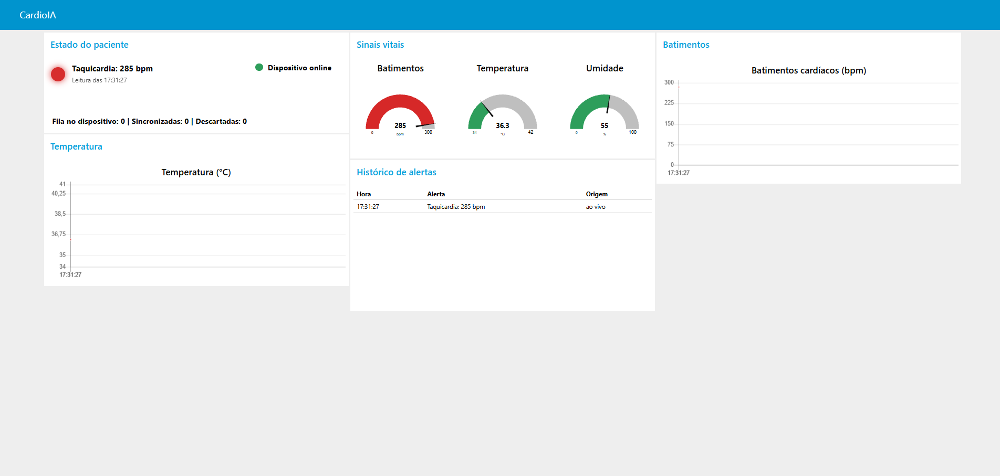
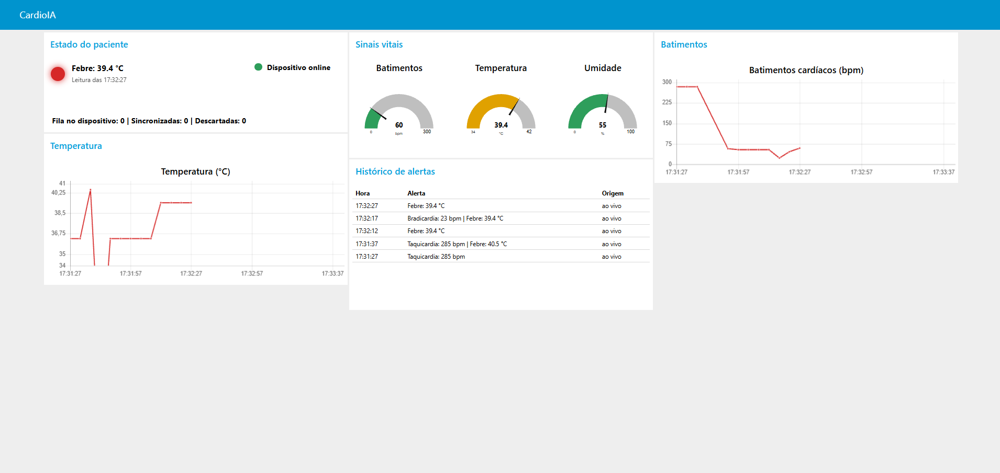
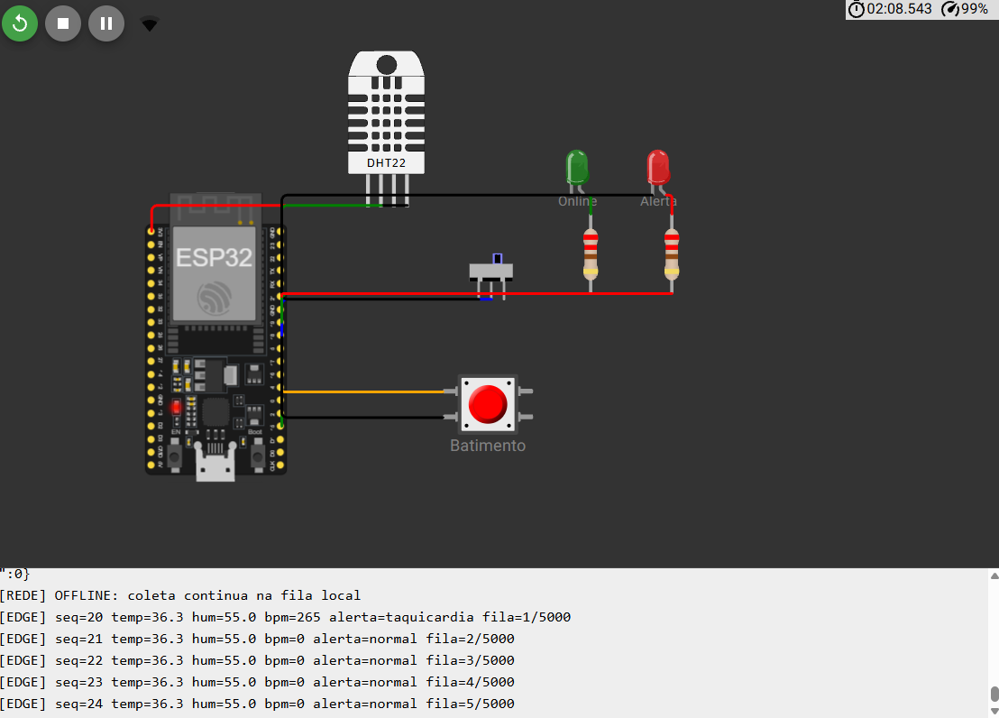
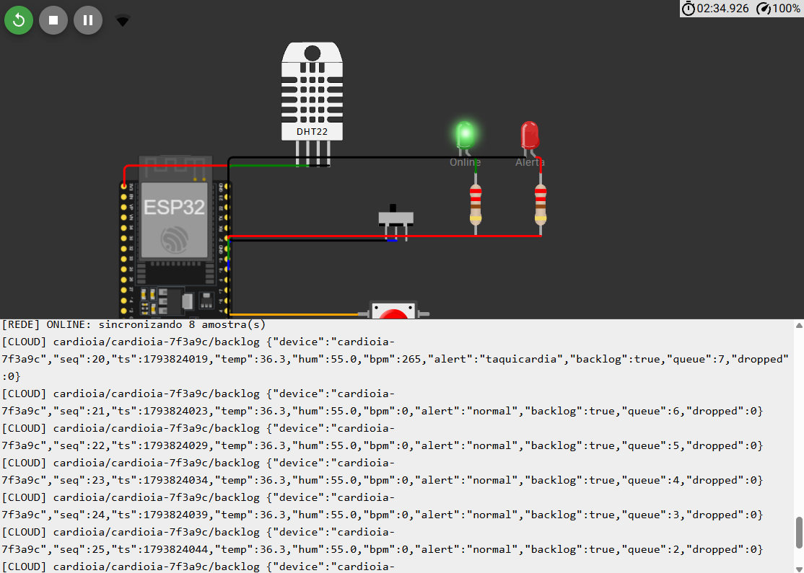
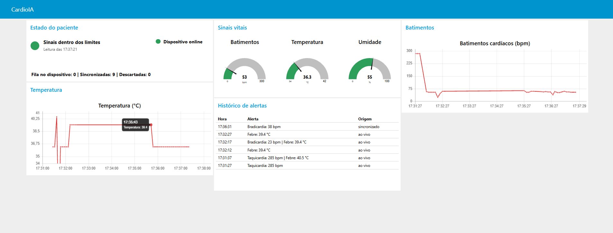

# CardioIA - Fase 3: Monitoramento Contínuo (IoT no Peito do Paciente)

Protótipo de wearable cardíaco simulado com ESP32. Ele captura sinais vitais, emite alertas locais, mantém os dados durante quedas de conexão, publica via MQTT e exibe tudo em um dashboard Node-RED.

> **Aviso:** projeto acadêmico. Os dados são **simulados**. O sistema não é um dispositivo médico e não deve ser usado para diagnóstico ou decisão clínica.

**Aluno:** Jefferson de Souza Oliveira - RM568138 - Turma 2TIAOR

## Links

- **Projeto no Wokwi:** https://wokwi.com/projects/479791201983250433
- **Relatório da Parte 1:** [docs/relatorio_parte1_edge.pdf](docs/relatorio_parte1_edge.pdf)
- **Relatório da Parte 2:** [docs/relatorio_parte2_mqtt_dashboard.pdf](docs/relatorio_parte2_mqtt_dashboard.pdf)

## Arquitetura

```text
DHT22 + botão → ESP32 (Wokwi) → MQTT sobre TLS → broker.hivemq.com → Node-RED → Dashboard
                  │
                  ├─ alerta local (LED)
                  └─ fila offline de 5.000 amostras
```

| Tópico | Conteúdo |
|---|---|
| `cardioia/cardioia-7f3a9c/vitals` | Leituras em tempo real |
| `cardioia/cardioia-7f3a9c/backlog` | Leituras coletadas offline |
| `cardioia/cardioia-7f3a9c/status` | `online` ou `offline` |

## Estrutura do repositório

```text
CardioIA_Fase3/
├── firmware/
│   ├── sketch.ino          # código comentado do ESP32
│   ├── ring_buffer.h       # fila circular da resiliência offline
│   ├── diagram.json        # circuito do Wokwi
│   ├── libraries.txt       # bibliotecas do Wokwi
│   ├── platformio.ini      # compilação local
│   └── wokwi.toml          # simulação local com a extensão do Wokwi
├── node-red/
│   └── flows.json          # export do dashboard
├── tools/
│   ├── simulador_mqtt.py   # publica dados de teste sem o Wokwi
│   ├── test_ring_buffer.cpp # testes da fila circular
│   └── requirements.txt
└── docs/
    ├── relatorio_parte1_edge.pdf
    ├── relatorio_parte2_mqtt_dashboard.pdf
    └── prints/             # evidências
```

## Como executar

### 1. Simulação do ESP32

Abra o [projeto no Wokwi](https://wokwi.com/projects/479791201983250433) e clique em **Play**.

| Controle | Ação |
|---|---|
| Botão **Batimento** | Cada toque simula um batimento. Três toques por segundo geram taquicardia |
| **DHT22** | Clique no sensor e suba a temperatura acima de 38 °C para gerar febre |
| **Chave** | Esquerda: conectado. Direita: sem conexão |

Para rodar só a Parte 1, sem rede, troque `MQTT_ENABLED` para `0` em `sketch.ino`. Nesse modo, o Monitor Serial faz o papel da nuvem.

### 2. Dashboard Node-RED

Requer Node.js.

```bash
npm install -g node-red
```

```bash
node-red
```

1. Abra http://localhost:1880.
2. Em **Menu → Manage palette → Install**, instale `node-red-dashboard`.
3. Em **Menu → Import**, selecione `node-red/flows.json` e clique em **Deploy**.
4. Abra o painel em http://localhost:1880/ui.

Deixe as janelas do Wokwi e do painel visíveis lado a lado, porque a simulação pode perder ritmo com a aba em segundo plano.

### 3. Testar o painel sem o Wokwi (opcional)

```bash
pip install -r tools/requirements.txt
```

```bash
python tools/simulador_mqtt.py --cenario completo
```

## Resiliência offline

Toda amostra entra em uma fila circular e só sai depois de o envio ser confirmado (QoS 1).

- **Capacidade:** 5.000 amostras a cada 5 s, cerca de 6,9 horas offline em 80 KB de RAM.
- **Fila cheia:** descarta a amostra mais antiga e contabiliza o descarte.
- **Reconexão:** envia em ordem pelo tópico `backlog`, com o horário real da captura.
- **SPIFFS:** não utilizado, por ser volátil nos simuladores. A fila em RAM se perde ao reiniciar o dispositivo.

## Limites de alerta

| Condição | Limite |
|---|---|
| Taquicardia | Acima de 120 bpm |
| Bradicardia | Abaixo de 50 bpm (com sinal) |
| Febre | Acima de 38 °C |

## Evidências

| Taquicardia no painel | Febre no painel |
|---|---|
|  |  |

| Coleta offline | Sincronização |
|---|---|
|  |  |



## Limitações e segurança

O projeto usa o broker público da HiveMQ, sem autenticação, porque o plano de nuvem encontrado era pago. Com dados simulados, isso é aceitável em um protótipo, mas **não seria com pacientes reais**: qualquer pessoa pode ler e publicar nos tópicos.

O firmware também não valida o certificado do broker (`setInsecure()`), e o painel não tem login. O relatório da Parte 2 detalha essas limitações e o que mudaria em produção.
