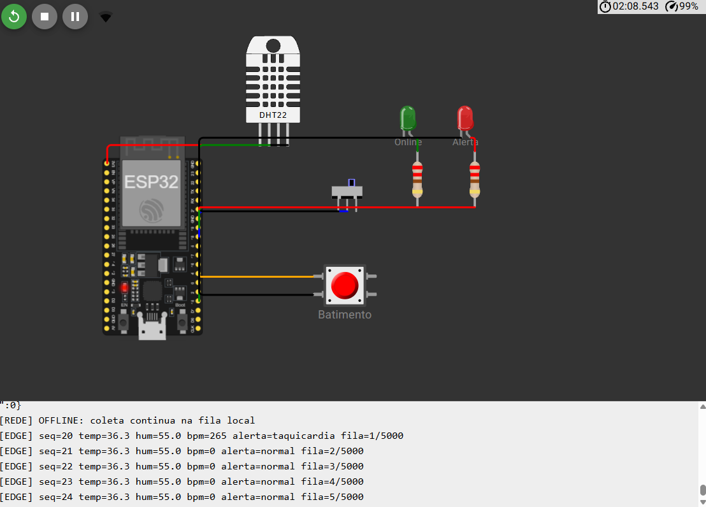
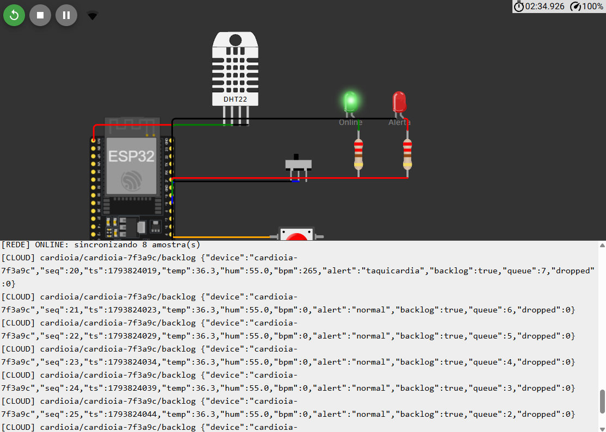

# CardioIA Fase 3 - Relatório da Parte 1: Armazenamento e processamento local (Edge Computing)

**Aluno:** Jefferson de Souza Oliveira - RM568138 - Turma 2TIAOR

**Projeto no Wokwi:** https://wokwi.com/projects/479791201983250433

## 1. Objetivo

Simular um wearable cardíaco em um ESP32 que continue coletando sinais vitais e avaliando alertas mesmo sem conexão, e que sincronize os dados pendentes quando a rede voltar. Os dados são simulados, e o protótipo não é um dispositivo médico.

## 2. Sensores e componentes

| Componente | Pino | Função |
|---|---|---|
| DHT22 | GPIO15 | Sensor 1: temperatura e umidade |
| Botão | GPIO4 | Sensor 2: cada toque simula um batimento |
| Chave deslizante | GPIO18 | Variável booleana de conectividade: esquerda = conectado |
| LED verde | GPIO19 | Indica conexão ativa |
| LED vermelho | GPIO21 | Alerta local, que funciona mesmo sem rede |

O DHT22 mede o ambiente em um circuito real. Neste protótipo, o valor ajustado no simulador representa a temperatura corporal.

## 3. Fluxo de funcionamento

1. **Captura:** a cada 5 segundos, o firmware lê o DHT22 e calcula o BPM. Uma interrupção registra o instante de cada toque, para que nenhum batimento se perca enquanto o programa usa a rede. O BPM é a média dos últimos intervalos e exige ao menos 3 toques. Sem toques por 10 segundos, o valor passa a 0 (sem sinal).
2. **Processamento local:** a amostra é comparada aos limites do projeto: taquicardia acima de 120 bpm, bradicardia abaixo de 50 bpm e febre acima de 38 °C. O LED de alerta responde na hora, sem depender da nuvem.
3. **Armazenamento:** toda amostra entra em uma fila circular na memória RAM, mesmo quando há conexão.
4. **Envio:** quando há conexão, as amostras saem da fila em ordem de chegada e são enviadas. Cada envio é registrado no Monitor Serial com `Serial.printf`, com o prefixo `[CLOUD]`.
5. **Remoção:** a amostra só é apagada depois de o envio ser confirmado, o que equivale a apagar o registro local após a sincronização.

Online e offline usam o mesmo caminho. Não existe uma rotina separada de sincronização, o que reduz a chance de os dois modos se comportarem de formas diferentes.

## 4. Lógica de resiliência

**Sem conexão:** a chave desliga a variável de conectividade, a coleta continua e a fila cresce. O Monitor Serial mostra `[REDE] OFFLINE` e o tamanho da fila.

**Ao reconectar:** as amostras pendentes são enviadas da mais antiga para a mais nova, em lotes de até 10 por ciclo, para não atrasar a captura. Se um envio falhar, a amostra permanece na fila e é reenviada depois.

**Horário das amostras:** cada amostra guarda o instante de captura pelo relógio interno. O horário real é calculado no envio (agora menos a idade da amostra), então os dados coletados offline mantêm o horário correto.

**Estratégia de armazenamento limitado:**

| Parâmetro | Valor |
|---|---|
| Capacidade da fila | 5.000 amostras |
| Intervalo entre amostras | 5 segundos |
| Autonomia sem conexão | cerca de 6,9 horas |
| Tamanho de cada amostra | 16 bytes |
| Memória usada | 80 KB de RAM |

A capacidade cobre uma saída prolongada do paciente, como uma jornada de trabalho parcial sem rede. Quando a fila enche, a amostra **mais antiga** é descartada e contabilizada no campo `dropped`, porque o estado recente do paciente tem mais valor clínico que o histórico antigo.

A primeira versão usava 20 bytes por amostra em um vetor estático, que não coube na memória junto com as bibliotecas de Wi-Fi e TLS: o programa não compilou. A solução foi guardar temperatura e umidade como inteiros em décimos, chegando a 16 bytes, e alocar a fila no início da execução.

## 5. Decisão sobre o SPIFFS

O SPIFFS é opcional no enunciado e volátil nos simuladores, então não foi usado. A fila em RAM foi escolhida por ter comportamento igual no simulador. O Monitor Serial faz o papel de registro de saída, como o enunciado permite. A consequência é que **reiniciar o dispositivo apaga a fila**. Em um produto real, seria necessário persistir os dados em flash ou em cartão microSD.

## 6. Testes realizados

| Cenário | Como foi testado | Resultado |
|---|---|---|
| Leitura dos sensores | Wokwi | Leituras e BPM exibidos a cada 5 s |
| Alerta local | Wokwi, com toques rápidos | LED vermelho aceso em taquicardia |
| Coleta offline | Wokwi, com a chave desligada | Fila subiu de 1 até 8 amostras |
| Sincronização | Wokwi, religando a chave | 8 amostras enviadas em ordem, e fila zerada |
| Fila cheia e descarte | Teste automatizado da fila no computador (`tools/test_ring_buffer.cpp`) | Mais antiga descartada, ordem preservada |

O descarte com a fila cheia não foi observado na simulação, porque encher 5.000 amostras levaria cerca de 6,9 horas. Ele foi verificado apenas no teste automatizado da fila.

## 7. Limitações

- Reiniciar o dispositivo perde a fila, como explicado na seção 5.
- O botão simula batimentos de forma aproximada: uma pausa nos toques pode gerar um valor baixo e um alerta de bradicardia antes de o sinal ser considerado ausente.
- A conectividade é controlada por uma chave, e não por uma queda real de rede. Ao desligá-la, o firmware encerra o MQTT, mas mantém a associação Wi-Fi.
