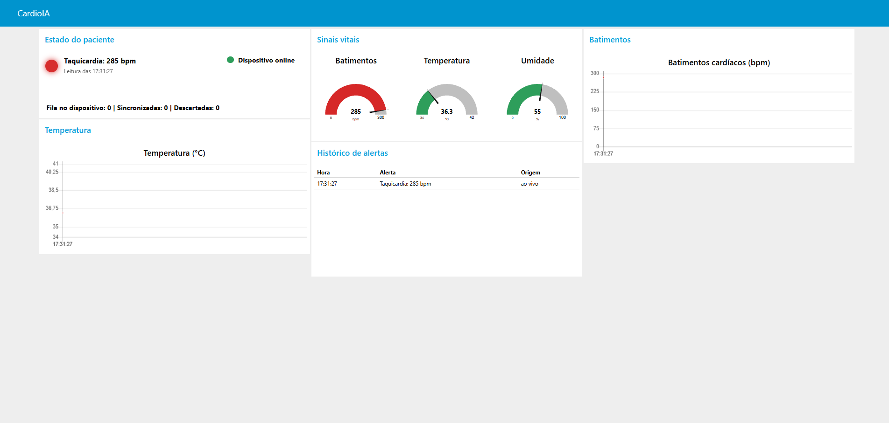
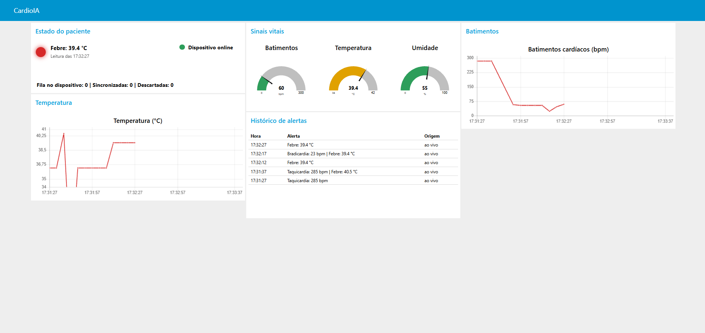
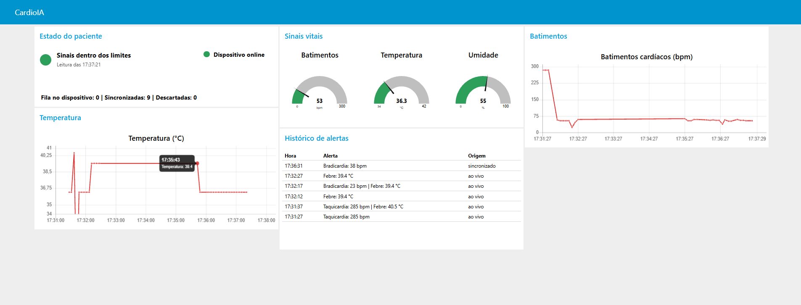

# CardioIA Fase 3 - Relatório da Parte 2: Transmissão MQTT e dashboard (Fog/Cloud Computing)

**Aluno:** Jefferson de Souza Oliveira - RM568138 - Turma 2TIAOR

**Projeto no Wokwi:** https://wokwi.com/projects/479791201983250433

## 1. Arquitetura

O sistema separa as responsabilidades em três camadas, como proposto no material da fase:

| Camada | Onde roda | Responsabilidade |
|---|---|---|
| Edge | ESP32 no Wokwi | Captura, alerta local, fila offline e publicação |
| Cloud | Broker público da HiveMQ | Recebe e distribui as mensagens |
| Fog | Node-RED no computador local | Valida, avalia limites e exibe o painel |

O caminho completo dos dados é: **sensores → ESP32 → MQTT sobre TLS → broker → Node-RED → dashboard**.

O Node-RED roda na máquina local, e não em um serviço de nuvem. Por isso, o painel só fica disponível enquanto o Node-RED estiver em execução. O Grafana Cloud é opcional no enunciado e não foi utilizado.

## 2. Por que MQTT

O MQTT usa o modelo publicar/assinar. O ESP32 não precisa conhecer quem consome os dados: ele publica em um tópico, e o broker entrega a quem assinou. O protocolo tem baixo custo de banda, o que combina com dispositivos vestíveis. Cada mensagem deste projeto tem cerca de 160 bytes; com uma amostra a cada 5 segundos, são cerca de 2,8 MB de dados úteis por dia, sem contar os cabeçalhos do protocolo.

## 3. Escolha do broker

O enunciado cita o HiveMQ Cloud como exemplo. Ao criar a conta, a opção de nuvem encontrada foi o plano Starter, com 15 dias de teste e custo estimado de US$ 249 por mês depois disso, inviável para um protótipo acadêmico e com risco de expirar antes da correção.

Por isso, foi usado o **broker público da HiveMQ** (`broker.hivemq.com`, porta 8883, com TLS). Ele não exige conta, e o link do Wokwi funciona para qualquer avaliador sem expor senhas. A contrapartida é não ter autenticação, o que é discutido na seção 8.

## 4. Tópicos e configuração MQTT

| Tópico | Conteúdo | QoS | Retida |
|---|---|---|---|
| `cardioia/cardioia-7f3a9c/vitals` | Leituras em tempo real | 1 | Não |
| `cardioia/cardioia-7f3a9c/backlog` | Leituras coletadas offline | 1 | Não |
| `cardioia/cardioia-7f3a9c/status` | `online` ou `offline` | 1 | Sim |

**QoS 1:** garante a entrega ao menos uma vez. A biblioteca usada (`arduino-mqtt`) só confirma a publicação depois de receber o PUBACK do broker, e só então a amostra sai da fila. A biblioteca PubSubClient foi descartada porque publica apenas em QoS 0, sem essa confirmação. Uma entrega duplicada é possível, e o número de sequência (`seq`) permite identificá-la.

**Tópico separado para o backlog:** ao reconectar, várias amostras antigas chegam de uma vez. Se usassem o mesmo tópico, os gauges e o alerta mostrariam dados antigos como se fossem o estado atual do paciente.

**Last Will e mensagem retida:** o dispositivo registra no broker uma mensagem `offline`, publicada automaticamente se a conexão cair sem aviso. Por ser retida, quem abrir o painel depois recebe o último status conhecido.

**Identificação do cliente:** o ID recebe um sufixo aleatório a cada execução, porque no broker público dois clientes com o mesmo ID derrubam um ao outro.

**Formato da mensagem:**

```
{"device":"cardioia-7f3a9c","seq":4,"ts":1793823938,"temp":36.5,"hum":55.0,
 "bpm":243,"alert":"taquicardia","backlog":false,"queue":0,"dropped":0}
```

## 5. Configuração do Node-RED

O fluxo está em `node-red/flows.json` e usa o pacote `node-red-dashboard`.

1. **Três nós `mqtt in`** assinam os tópicos exatos do dispositivo, com QoS 1 e TLS. O curinga `cardioia/+/...` foi evitado, porque captaria mensagens de terceiros no broker público.
2. **O nó de função "Avaliar limites"** valida cada mensagem, aplica os limites e distribui os dados para oito saídas.
3. **O nó de função "Status do dispositivo"** aceita apenas `online` ou `offline` e atualiza o indicador de conexão.

Como qualquer pessoa pode publicar nesses tópicos, só são aceitas mensagens com o identificador esperado, tipos corretos e valores em faixas plausíveis. Em um teste, três mensagens inválidas foram enviadas (texto que não é JSON, outro dispositivo e 9.999 bpm), e nenhuma chegou ao painel. Isso filtra erros e ruído, mas **não impede falsificação**: quem conhece o formato consegue publicar uma mensagem que passe na validação.

## 6. Componentes do dashboard

| Requisito | Implementação |
|---|---|
| Gráfico de sinal vital | Gráficos de BPM e de temperatura, com os últimos 30 minutos |
| Medidor (gauge) | Gauges de BPM, temperatura e umidade |
| Indicador de alerta | LED virtual: verde (normal), amarelo (sem sinal), vermelho piscante (alerta) |
| Apoio | Status do dispositivo, tamanho da fila, sincronizadas, descartadas e histórico de alertas |

**Limites de alerta:**

| Condição | Limite |
|---|---|
| Taquicardia | Acima de 120 bpm |
| Bradicardia | Abaixo de 50 bpm (com sinal) |
| Febre | Acima de 38 °C |

As amostras do backlog entram nos gráficos no horário real da captura e no histórico marcadas como "sincronizado", mas não alteram os gauges nem o alerta atual. O histórico registra apenas o início de cada alerta, comparando o tipo e não o valor, para não repetir o mesmo evento a cada leitura.

Os limites são exemplos do projeto, não critérios clínicos validados. Uma frequência de 130 bpm durante exercício, por exemplo, pode ser normal, e o sistema não considera o contexto do paciente.

## 7. Testes e evidências

| Cenário | Resultado |
|---|---|
| ESP32 no Wokwi publicando no broker real | Dados recebidos no painel |
| Taquicardia | LED virtual vermelho, gauge e histórico atualizados |
| Febre (DHT22 acima de 38 °C) | Alerta exibido e registrado |
| Taquicardia e febre juntas | Os dois alertas exibidos |
| Offline e reconexão | 9 amostras sincronizadas, sem alterar o alerta atual; alerta antigo registrado como "sincronizado" na ordem correta |
| Mensagens inválidas | Ignoradas pelo Node-RED |







Durante os testes, as leituras chegaram com atraso em relação ao relógio quando a aba do Wokwi ficou em segundo plano. A causa provável é o navegador reduzir o ritmo de abas em segundo plano; a demonstração funciona melhor com as duas janelas visíveis.

## 8. Eficiência, segurança e boas práticas

**Eficiência:** o alerta local não depende da rede, a fila limita o uso de memória e cada mensagem tem cerca de 160 bytes. O envio em lotes evita que a sincronização atrase a captura.

**O que o protótipo já aplica:** criptografia TLS no transporte, nenhuma senha no código, validação de entrada no Node-RED e uso exclusivo de dados simulados, sem nome ou identificação de pacientes.

**Limitações de segurança conhecidas:**

- O broker é público: qualquer pessoa pode ler e publicar nos tópicos, que também aparecem neste repositório.
- O firmware usa `setInsecure()`: o tráfego é criptografado, mas o certificado do broker não é validado, o que permitiria um ataque de intermediário.
- O painel local não tem login.
- Não há armazenamento histórico: contadores e histórico ficam na memória do Node-RED e se perdem ao reiniciá-lo.

**O que mudaria em produção:** dados de saúde são sensíveis pela LGPD, então este arranjo **não seria aceitável com pacientes reais**. Seria necessário usar broker privado, credenciais por dispositivo, controle de acesso por tópico, validação de certificado, login no painel, banco de dados com retenção definida e registro de acessos.

## 9. Conclusão

O protótipo cumpre o ciclo pedido: captura, processamento, transmissão, visualização e alerta. A principal lição é a divisão de papéis: o alerta imediato fica na borda, onde não depende da rede, enquanto a visão consolidada fica no painel. O teste em simulador também revelou problemas que não apareceriam só na leitura do código, como o limite de memória com TLS e os falsos alertas nos primeiros toques.
